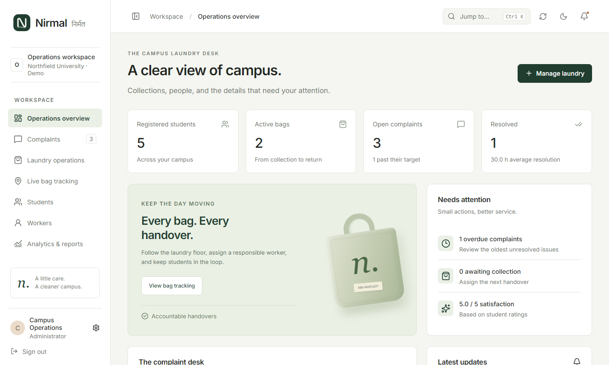
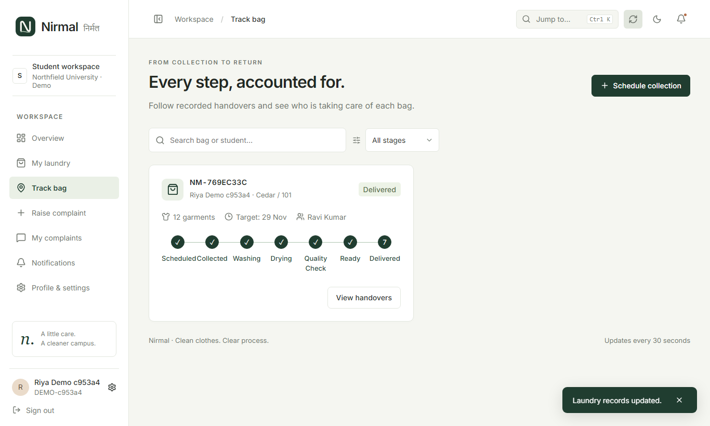
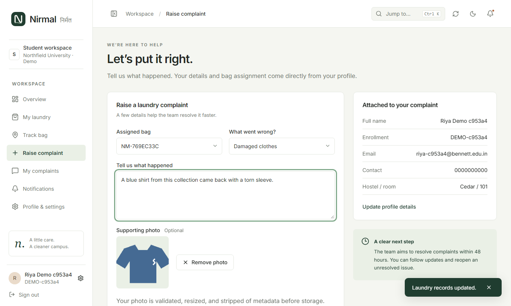
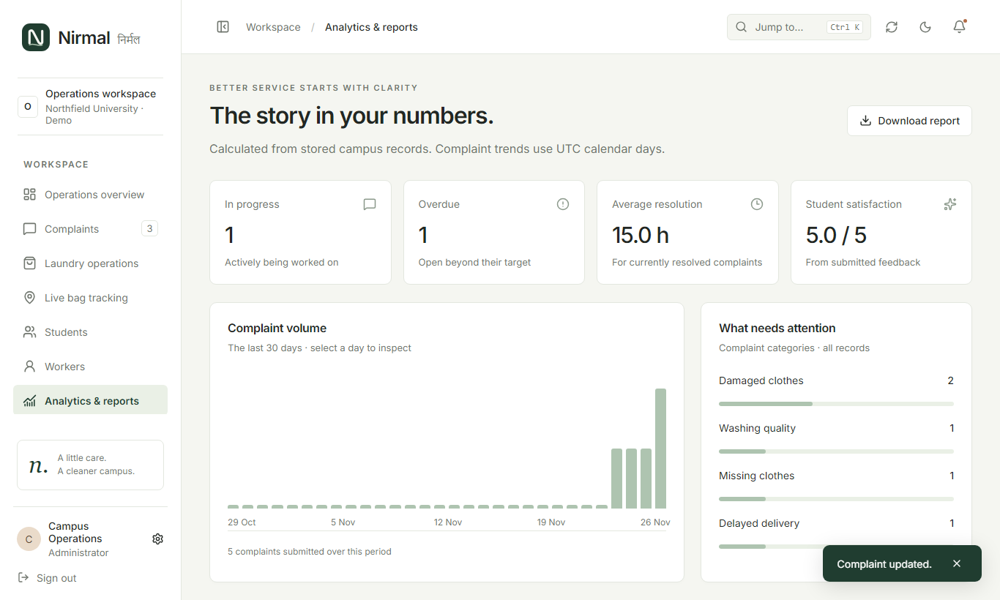

<div align="center">


# Nirmal · निर्मल

**Campus laundry tracking and complaint resolution**

[**Open the live app ↗**](https://nirmal-seven.vercel.app/) · [**Watch the 2:26 demo ▶**](docs/Nirmal-Prototype-Demo.mp4)

[](https://nirmal-seven.vercel.app/)
[](src)
[](package.json)

</div>

Students can see where their laundry is, what happened at each handover, and who is handling a complaint. The laundry desk can assign bags, record each stage, and follow up on overdue cases from one workspace.

[**Screens**](#see-nirmal-in-action) · [**Workflows**](#how-it-works) · [**Get started**](#get-started) · [**Architecture**](#architecture-and-checks)

## See Nirmal in action

[](docs/screenshots/admin-overview.png)

*The administrator dashboard summarizes current collections, complaints and items needing attention. All screenshots use fictional demo records. Select an image to open it at full size.*

| Track a bag | Report a laundry problem |
| --- | --- |
| [](docs/screenshots/bag-tracking.png) | [](docs/screenshots/complaint-form.png) |
| See the worker, target date, garment count and handover history. | Choose an assigned bag, describe the issue and attach an optional photo. |

<details>
<summary><strong>Explore the analytics and reports screen</strong></summary>

[](docs/screenshots/analytics.png)

Administrators can inspect daily complaint volume, overdue cases, resolution time, student ratings and worker activity. The workspace supports CSV exports for further review.

</details>

## How it works

| Student workspace | Administrator workspace |
| --- | --- |
| Register with a campus email, schedule collections, track assigned bags and check notifications. | Assign bags to active students, record handovers and attach a responsible worker to each stage. |
| Submit a bag-linked complaint with optional evidence, follow the timeline, rate the outcome or reopen the issue. | Search the complaint queue, assign workers, record resolution notes and review service metrics. |

<details>
<summary><strong>Follow a laundry collection</strong></summary>

1. An administrator assigns a bag to an active student.
2. The student selects the bag and schedules a collection for 1–50 garments.
3. The laundry desk records each worker handover and adds a note.
4. The student checks the timeline and in-app updates. A delivered bag becomes available for another collection.

```text
Scheduled → Collected → Washing → Drying → Quality Check → Ready → Delivered
```

</details>

<details>
<summary><strong>Follow a complaint from submission to resolution</strong></summary>

1. The student selects a bag, describes the issue and optionally attaches a JPEG or PNG up to 2 MiB.
2. The server verifies bag ownership and creates a unique complaint reference.
3. The administrator reviews the case, assigns a worker and records notes as the complaint advances.
4. The student can rate the outcome or reopen a resolved or closed complaint. Reopening returns it to review and keeps the event history.

```text
Submitted → Under Review → Assigned → In Progress → Resolved → Closed
```

</details>

## Get started

**Live website**  [https://nirmal-seven.vercel.app/](https://nirmal-seven.vercel.app/)

Students can select **Create an account** and register with their full `@bennett.edu.in` email address. Once the laundry desk assigns a bag, it appears under **My laundry** and in the complaint form.

## Architecture and checks

| Layer | Implementation |
| --- | --- |
| Interface | React, Vite, Inter, Lucide and Motion |
| API | Express on Node.js with role checks, session cookies and server-side ownership checks |
| Storage | SQLite for local development and Turso for the Vercel deployment |
| Hosting | Vercel serves the client and routes API requests to the backend |

```powershell
npm test          # API workflows, account isolation, images and persistence
npm run check:ui  # Student, administrator and authentication render checks
npm run build     # Production assets and dependency notices
```

Read the [project report](docs/PROJECT_REPORT.md) for objectives, scope and the demo walkthrough. The [system design](docs/SYSTEM_DESIGN.md) covers the database, state transitions, API routes and metrics. Asset details and dependency notices are in [Provenance](PROVENANCE.md) and [Third-party notices](THIRD_PARTY_NOTICES.md).
