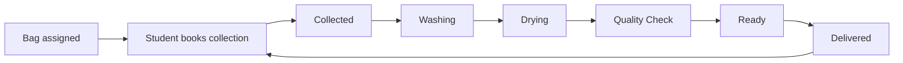
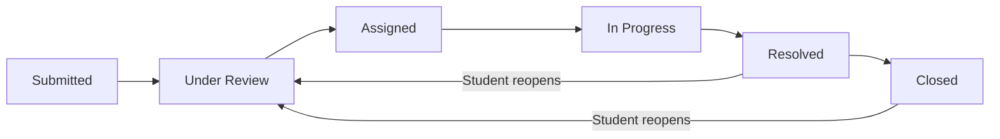

# Nirmal Project Report

**Application:** Nirmal — निर्मल  
**Tagline:** Clean clothes. Clear process.  
**Version:** 0.1.0  
**Report date:** 27 November 2026  
**Audience:** Project evaluators, campus operations staff, and developers

For the database dictionary, API contracts, security rules, screen specifications, and technical diagrams, see [System Design and Working Specification](SYSTEM_DESIGN.md).

## Executive overview

Nirmal is a campus laundry management application that connects student requests with administrative action. A student can see assigned bags, schedule a collection, follow recorded laundry stages, report a problem, and track its resolution. An administrator can assign bags, record worker handovers, investigate complaints, communicate progress, and inspect service metrics.

The application addresses a practical communication gap: students need a clear account of where their clothes are and what is being done when something goes wrong. Nirmal stores collections, complaints, progress notes, and notifications in a relational database so that these activities remain available after the server restarts.

The implemented system is a local web application with a React interface, an Express API, and SQLite storage. It supports genuine account authentication and role-specific access. It is suitable for demonstration and further campus pilot development. Public deployment requires the operational work described below; browser-based usability and accessibility verification remain outstanding.

## Objectives and scope

The principal objectives are to:

1. Make the current stage and target return date of each laundry collection visible.
2. Connect every complaint to an authenticated student and an assigned bag.
3. Record the administrator and responsible worker involved in laundry handovers.
4. Provide a structured complaint lifecycle with progress notes, resolution feedback, and reopening.
5. Calculate service metrics from stored records rather than hard-coded dashboard figures.
6. Keep one student's records inaccessible to another student.

The supported complaint categories are missing clothes, damaged clothes, delayed delivery, an incorrect bag, washing quality, and other laundry issues. Hostel maintenance, networking, IT support, and unrelated campus services are outside the scope.

Tracking means following stages recorded by administrators. It is not GPS tracking, automatic machine telemetry, or QR scanning. Workers are operational records assigned by administrators; they do not have a separate login in this version. The system uses explicit workflow rules, not AI classification or predictions.

## Users and functionality

| User | Main functions | Access boundary |
| --- | --- | --- |
| Student | Register, maintain contact details, view bags, book collections, submit complaints and photos, follow updates, rate a resolution, reopen an unresolved complaint | Own bags, complaints, evidence, and notifications |
| Administrator | Assign bags, record collection stages, assign workers, advance complaints, manage availability, view students and reports, configure service targets | Campus operational records; administrator's own notification inbox |
| Local operator | Configure the server, create the initial administrator, configure mail, generate an assisted reset link, maintain data | Requires access to the server environment and database |

Student account registration captures name, enrollment number, university email, contact number, hostel block, room number, and password. Registration always creates a student account. Administrator creation is an explicit operator command.

Student management currently supports listing, searching, exporting, and activation/deactivation. It does not provide an administrator form to edit enrollment numbers or email addresses. Worker management supports creation, availability, and activity summaries. Historical records remain when a person is deactivated.

## How the application works

### Account entry

A student registers or signs in using an email address and password. The server verifies the credentials and issues an HttpOnly session cookie. The interface asks the server for the current account and opens the appropriate workspace. Protected API calls recheck that the account remains active.

A password change requires the current password and signs out other sessions. A forgotten-password flow sends a one-time link when SMTP is configured. Without SMTP, the interface directs the student to the campus administrator; an operator can generate a reset link locally.

### Laundry collection

An administrator assigns a new bag to a registered, active student. The student selects an available bag and enters the garment count. The server checks ownership and ensures that the bag has no unfinished collection. It creates a collection in the Scheduled state and calculates the target return time using the current delivery-hours setting.



For each administrative stage change, a worker and handover note are required. The system records the new stage, the administrator who entered it, the responsible worker, and the timestamp. The student receives an in-app notification. Once the collection is Delivered, the bag becomes available for a new collection; the earlier collection remains in its history.

### Complaint handling

The student selects an assigned bag and a complaint category, describes the issue, and optionally attaches a JPEG or PNG photo. Personal details are obtained from the authenticated account rather than accepted as arbitrary complaint identity fields. The server validates the request, processes the image, generates a complaint reference, and writes the complaint, first event, and notifications together.



Administrative progress moves one step at a time. A progress note is mandatory, and an active worker is required from Assigned onward. Students can view the timeline and resolution notes. Once the complaint is Resolved or Closed, the student can give a rating from one to five and optional feedback.

If the issue remains unresolved, the student can reopen it with a reason. The complaint returns to Under Review. Earlier events stay visible, the original deadline remains unchanged, and the current resolution timestamp, rating, and feedback are cleared. The existing worker assignment is retained until the next assignment decision.

### Example operational scenario

A student reports a missing blue shirt from their assigned bag. The administrator reviews the collection history, assigns a worker, and records the search as In Progress. After the item is found and returned, the administrator records a resolution note. The student checks the result and submits feedback. If the returned item is the wrong size, the student reopens the complaint, making the issue visible to administrators again without starting a disconnected record.

## Technology and architecture

| Layer | Technology | Responsibility |
| --- | --- | --- |
| Browser interface | React 19.3.1 | Forms, navigation, tables, timelines, dashboard state |
| Build system | Vite 8.4.0 | Compiles the client into `dist/` |
| Server | Node.js 24+ and Express 5.3.0 | Same-origin application serving and JSON endpoints |
| Persistence | Built-in `node:sqlite` | Accounts, bags, collections, complaints, events, notifications, settings |
| Password and token handling | Node crypto | Salted scrypt hashes, random secrets, token digests |
| Request protections | Helmet and express-rate-limit | Response headers and request throttling |
| Optional email | Nodemailer | Password reset messages through configured SMTP |
| Image processing | jpeg-js and pngjs | Decode evidence and re-encode sanitized PNG pixels |
| Visual assets | Inter, Lucide, Motion, SVG and CSS | Typography, icons, transitions, branding and illustrations |

One application server serves the compiled interface and `/api` endpoints. This keeps setup manageable and avoids a separate browser-to-API origin configuration. The database is a local file with foreign keys and write-ahead logging enabled. A transaction either commits a related state change and its events together or rolls them back together.

This design favors a modest single-server installation. It does not yet provide multi-campus tenancy, horizontally distributed sessions or throttling, background workers, or large-data pagination.

## Interface design

The interface uses a forest-green, ivory, charcoal, and sage palette. The layout places stable navigation in a sidebar and the main task in the content area. Summary cards answer common questions first; tables and timelines provide the detail behind those figures.

The student workspace contains Overview, My laundry, Track bag, Raise complaint, My complaints, Notifications, and Profile & settings. The administrator workspace contains Operations overview, Complaints, Laundry operations, Live bag tracking, Students, Workers, Analytics & reports, Notifications, and System settings.

Light and dark themes are supported. Desktop navigation can collapse to icons, and mobile navigation becomes an overlay. The interface includes search/filter controls, a Ctrl/Cmd+K page navigator, visible form errors, busy states, photo previews, empty states, and confirmation dialogs. A 30-second refresh interval retrieves updates, with a manual refresh button available as well.

Accessibility features in the implementation include input labels, visible focus styles, status text, a skip-to-content link, dialog controls, live status messages, and reduced-motion handling. These are implementation features, not a claim of completed accessibility certification.

## Testing and evaluation

The following checks were rerun on 27 November 2026:

| Check | Result | What it establishes |
| --- | --- | --- |
| `npm test` | 9 tests passed, 0 failed | API workflows, ownership boundaries, session/reset handling, transactional events, evidence validation and persistence |
| `npm run check:ui` | 34 views rendered successfully | Populated and empty student/admin views and authentication views can render without the checked runtime failures |
| Production build and HTTP smoke checks | Passed during implementation | Compiled client, login, analytics and dependency-notice endpoint served successfully |
| Browser interaction and visual checks | Not completed | Browser access host was unavailable; responsive layout and real user interaction still require verification |

The tests include attempts to read another student's complaints and images, skip workflow stages, submit stale updates, reuse reset tokens, and use malformed evidence. They also verify that completed collections allow a new booking and that records survive closing and reopening SQLite.

These results support the implemented business rules; they do not measure service adoption, student satisfaction in a real deployment, concurrency capacity, or campus-scale performance. Demonstration dashboard data is fictional and should not be reported as an operational outcome.

## Installation and demonstration

Requirements are Node.js 24 or newer, npm, a modern browser, and writable storage for the database. From the `Nirmal` directory:

```powershell
npm ci
npm run build
npm run demo
npm start
```

Alternatively, double-click the workspace's `START-NIRMAL.bat`. Open `http://localhost:4173`. Demo data is created only for an empty account database by the seed script.

| Demo role | Email | Password |
| --- | --- | --- |
| Student | student@nirmal.example | Nirmal-demo-2026! |
| Administrator | admin@nirmal.example | Nirmal-demo-2026! |
| Second student | meera@nirmal.example | Nirmal-demo-2026! |

Use separate browser profiles to keep student and administrator sessions open simultaneously. For a demonstration, show a student's bag, schedule an available collection, advance it as administrator, submit a complaint, progress it through resolution, and return as the student to give feedback or reopen it. Show the second student's account to demonstrate that the first student's complaints are absent.

**Email-domain configuration**

The example sets `UNIVERSITY_EMAIL_DOMAIN=bennett.edu.in`. Copy the setting into `.env` to restrict new registrations to Bennett addresses. Students enter their full email address. An empty setting allows other domains. Email ownership verification requires a separate step.

## Deployment requirements and future work

Before using real campus records, set up a fresh database, provision a non-demo administrator, configure HTTPS and production cookies, verify SMTP delivery, and establish database backup and restore procedures. Configure the actual application origin, campus domain, and service targets. Browser interaction, mobile layout, accessibility, security, and load testing should be completed before a public launch.

Prioritized enhancements are:

| Priority | Enhancement | Reason |
| --- | --- | --- |
| 1 | Email ownership verification or university SSO | Establish that the person registering controls the campus identity |
| 1 | Versioned database migrations and tested backups | Support upgrades and recovery without losing records |
| 1 | Browser and accessibility test suite | Validate keyboard, mobile, upload, dialog, and navigation behavior |
| 2 | Pagination, server-side search, background image processing | Keep latency and memory use manageable as usage grows |
| 2 | Background deadline alerts and mail retry queue | Follow up overdue work and temporary delivery failures |
| 2 | Administrative identity correction workflow | Correct student details with an audit trail |
| 3 | Worker login, QR collection and verified handover | Reduce manual entry and strengthen physical bag identification |
| 3 | Multi-campus isolation and richer operational analysis | Support expansion beyond a single campus instance |

The current application delivers the core digital record from bag assignment to collection return and complaint resolution. Its usefulness depends on staff recording accurate handovers and following through on the operational actions represented by those records.
