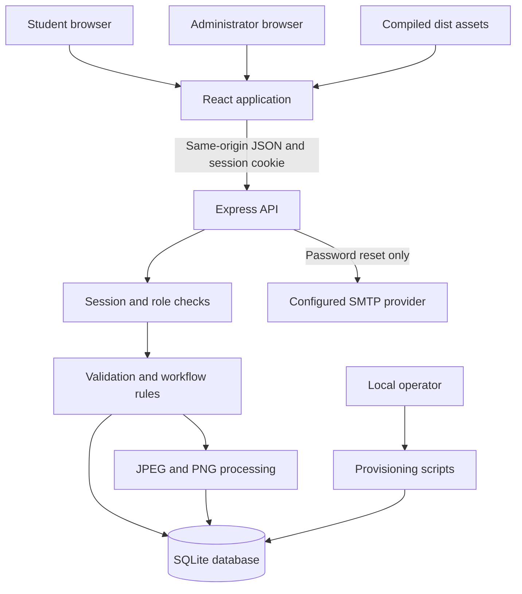
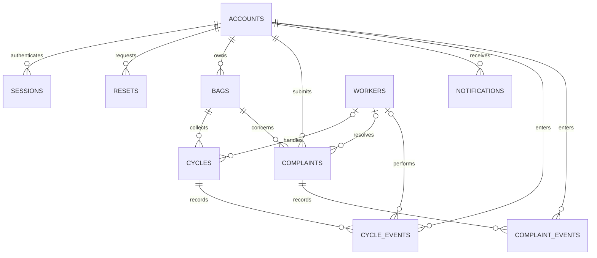
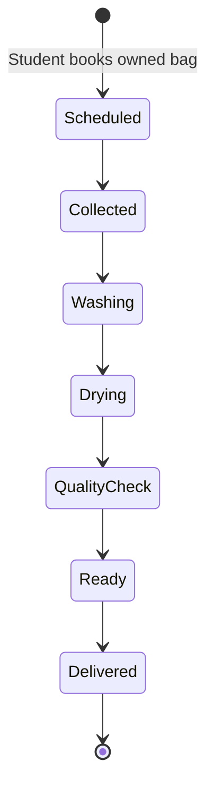
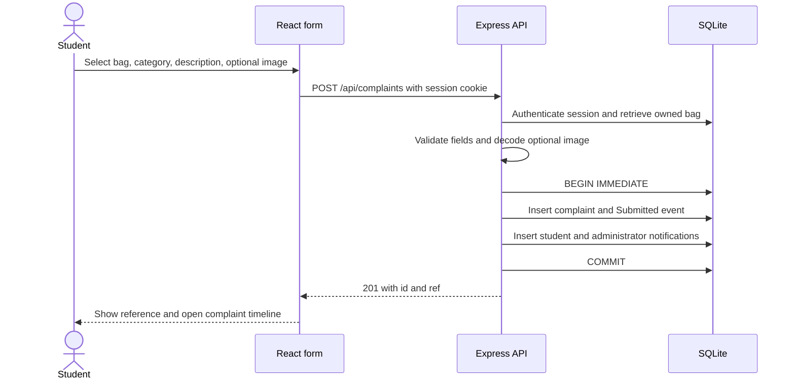

# Nirmal System Design and Working Specification

**Version:** 0.1.0 · **Date:** 27 November 2026  
This specification describes the current implementation. Proposed extensions are labeled separately. For project objectives and the demonstration walkthrough, see [Project Report](PROJECT_REPORT.md).

## Architecture

### Components and deployment boundary



The server entry point loads `.env` when present, opens the database, creates the API, serves `dist/`, and listens on `127.0.0.1:4173` by default. It refuses startup if the compiled `index.html` is missing. SIGINT and SIGTERM close the HTTP listener and database. SMTP is the only optional external service used by application business logic.

| File or directory | Responsibility |
| --- | --- |
| `src/main.jsx` | React mounting, local font and stylesheet imports |
| `src/App.jsx` | Session bootstrap, role-specific navigation, data refresh, theme and page shell |
| `src/Auth.jsx` | Login, registration and password-reset forms |
| `src/pages.jsx` | Student/admin operational screens |
| `src/shared.jsx` | HTTP helpers, forms, dialogs, timelines, badges and CSV download |
| `src/style.css` | Design tokens, layout, responsive rules and CSS illustrations |
| `server/index.js` | Environment loading, HTTP startup and static serving |
| `server/app.js` | Routing, authorization, business workflows, SQL queries and error responses |
| `server/db.js` | Initial schema, indexes and transaction helper |
| `server/security.js` | Validation, password hashing and token functions |
| `server/images.js` | Evidence decoding, pixel limits, resizing and PNG encoding |
| `scripts/seed.js` | Explicit fictional demo initialization |
| `scripts/admin.js` | First-admin creation and assisted reset links |
| `test/` | API integration, image and view-render checks |

### Browser state and refresh

Navigation uses URL fragments such as `#laundry` and `#complaints/<id>`. The server serves the application root; no server-side route exists for each screen. `/api/me` determines the initial identity. Protected data loads through parallel API requests and is refreshed every 30 seconds, after successful changes, or through the refresh control.

The shell checks the current account and refresh sequence before accepting asynchronous results. This prevents an older response from replacing a newer workspace result. A 401 response during workspace refresh clears the session view. Complaint details reload when their record version changes rather than unmounting their form on every routine poll. Theme is the only application preference persisted in localStorage; authentication secrets remain in cookies.

## Database design

### Relationships



`settings` is an independent key/value table. Workers are not rows in `accounts`: assignment to a worker does not grant that worker access to the application.

### Data dictionary

Unless noted otherwise, IDs and timestamps are stored as SQLite TEXT. Entity IDs are UUIDs; timestamps use ISO UTC strings. Session and reset expiry values are integer epoch milliseconds. Event IDs are integer primary keys.

| Table | Fields and meaning |
| --- | --- |
| `accounts` | `id` primary key; `name`; case-insensitive unique `email`; `password` salted hash; `role` restricted to student/admin; unique nullable `enrollment`; `phone`; `hostel`; `room`; integer `active` default 1; `created_at` |
| `sessions` | `token` primary key containing a SHA-256 digest; `account_id` foreign key; integer `expires` |
| `resets` | `token` digest primary key; `account_id` foreign key; integer `expires` |
| `workers` | `id` primary key; `name`; `specialty`; integer `active` default 1 |
| `bags` | `id` primary key; unique `label`; required `owner_id` foreign key; `created_at` |
| `cycles` | `id`; `bag_id`; `status`; integer `garments` constrained to 1–50; nullable `worker_id`; `created_at`; `due_at`; nullable `delivered_at`; integer `version` default 1 |
| `cycle_events` | Integer `id`; `cycle_id`; `status`; `note`; required `actor_id`; nullable `worker_id`; `created_at` |
| `complaints` | `id`; unique `ref`; `student_id`; `bag_id`; `category`; `description`; `status`; nullable `worker_id`; nullable BLOB `photo` and `photo_mime`; `created_at`; `due_at`; nullable `resolved_at`; nullable integer `rating` constrained to 1–5; nullable `feedback`; integer `version` default 1 |
| `complaint_events` | Integer `id`; `complaint_id`; `status`; `note`; `actor_id`; `created_at` |
| `notifications` | `id`; `account_id`; `title`; `body`; fragment destination `target`; integer `seen` default 0; `created_at` |
| `settings` | `key` primary key and `value`; initial keys: `resolution_hours=48`, `delivery_hours=48`, `campus_name=Campus laundry` |

An administrator account may have no enrollment. Student registration requires it. Complaint identity details shown in the UI are joined from the current account, not saved as an immutable identity snapshot. Historical worker attribution is present in collection events; complaint events record the acting account while the complaint holds its current assigned worker.

### Integrity and storage rules

- Foreign keys are enabled. No application deletion endpoint removes historical accounts, bags or events.
- The partial unique index `one_active_cycle` permits only one non-Delivered cycle per bag.
- `complaint_owner(student_id, created_at)`, `bag_owner(owner_id)` and `notification_owner(account_id, created_at)` support ownership-filtered reads.
- WAL is enabled and busy timeout is 5 seconds. Synchronous SQL runs in the application process.
- Multi-row workflows use `BEGIN IMMEDIATE`, followed by COMMIT or ROLLBACK.
- Status values and transition order are enforced by application code; cycle and complaint status columns do not have SQL enum CHECK constraints.
- Initial schema creation is idempotent and sets `user_version=1`. It is not a versioned upgrade/migration system.
- Bag labels use `NM-` plus four random bytes encoded as uppercase hex. Complaint references use `NM-` plus five random bytes encoded as uppercase hex. Unique database constraints enforce uniqueness; there is no explicit collision retry loop.

## Workflow design

### Account lifecycle

Registration validates identity fields, checks an optional email-domain restriction, hashes the password, inserts a student account, and creates an eight-hour session. The request cannot select an administrator role. Duplicate email/enrollment records are rejected.

Login validates email format, finds the account, compares the password hash, checks availability, and creates a session. Unknown accounts undergo a dummy password comparison before rejection. Each protected request looks up the hashed cookie token, checks expiry, and joins to an active account.

Logout removes the current session. Password change removes all existing sessions and creates a new one for the successful request. Password reset removes all sessions and consumes the account's outstanding reset records. Deactivating a student removes sessions and prevents login until reactivation.

### Collection state machine



`QualityCheck` in the diagram corresponds to the stored text `Quality Check`. Booking accepts 1–50 garments and rejects a bag with an unfinished cycle. Every subsequent transition is administrator-only, advances exactly one stage, validates the submitted version, requires an active worker, and requires a 3–1000-character note. Delivered records receive `delivered_at`. No cancellation, backward transition, or exception state is implemented.

The return target equals booking time plus `delivery_hours`. This is a service target, not a selected pickup appointment. Changes to the setting affect subsequent bookings, not existing deadlines.

### Complaint state machine

| Current state | Allowed normal next state | Action and constraints |
| --- | --- | --- |
| Submitted | Under Review | Administrator adds a review note |
| Under Review | Assigned | Administrator selects an active worker and adds a note |
| Assigned | In Progress | Administrator confirms an active worker and adds a note |
| In Progress | Resolved | Administrator supplies resolution notes; `resolved_at` is set |
| Resolved | Closed | Administrator closes with a note and valid worker |
| Resolved or Closed | Under Review | Owning student supplies a reopening reason; resolution and feedback fields are cleared |

The complaint target equals creation time plus `resolution_hours`. Reopening preserves the original deadline and current worker assignment. Students may submit or replace feedback only while the complaint is Resolved or Closed. Feedback updates increment the record version but do not append a timeline event or trigger an admin notification.

### Submission and notification sequence



Notifications are saved during the corresponding transaction for bag assignment, collection requests/stage changes, complaint creation/status changes, and complaint reopening. The inbox returns the newest 100 notifications for the current account. Mark-all-read applies to that account's records, including older ones beyond the displayed 100. Delivery is in-app polling; there are no WebSockets, push messages, or complaint emails.

### Concurrent updates

An update includes the integer `version` displayed by the client. Inside the write transaction, the server reads the current row and compares versions. If they differ, it returns 409 without applying the change. A successful update increments the version and writes the event/notification before committing. For example, two administrators editing version 3 cannot both advance it: after the first commits version 4, the second must refresh.

## API specification

All routes below use the `/api` prefix. JSON request bodies are required for writes. Authentication uses the `nirmal_session` cookie, not a bearer token. Successful create routes normally return 201; other successful operations return 200. IDs shown in paths are record IDs, not public complaint references.

### Identity and settings

| Method and path | Access | Input or behavior |
| --- | --- | --- |
| `GET /health` | Public | `{ok:true}` service response |
| `POST /auth/register` | Public | `name,email,password,enrollment,phone,hostel,room`; returns public account and session cookie |
| `POST /auth/login` | Public | `email,password`; returns public account and session cookie |
| `POST /auth/forgot` | Public | `email`; sends reset link if configured and account exists |
| `POST /auth/reset` | Public | `token,password`; consumes valid token and revokes sessions |
| `GET /me` | Signed in | Current account without password hash |
| `POST /logout` | Signed in | Empty JSON object; clears current session |
| `PATCH /profile` | Signed in | `name,phone,hostel,room`; student enrollment/email/role cannot be changed here |
| `POST /password` | Signed in | `current,password`; changes password and rotates sessions |
| `GET /settings` | Signed in | Campus name and target-hour strings |
| `PATCH /settings` | Admin | `campus_name,resolution_hours,delivery_hours`; numeric targets 1–336 |

### Laundry and complaints

| Method and path | Access | Input or behavior |
| --- | --- | --- |
| `GET /bags` | Student/admin | Owned bags for student, all bags for admin; nested cycles, worker names and events |
| `POST /bags` | Admin | `owner_id` of active student; creates assigned bag and returns `id,label` |
| `POST /cycles` | Student | `bag_id,garments`; creates Scheduled cycle and returns `id` |
| `PATCH /cycles/:id` | Admin | `status,worker_id,note,version`; advances one stage |
| `GET /complaints` | Student/admin | Ownership-filtered or campus-wide summary list; includes `has_photo`, not image bytes |
| `POST /complaints` | Student | `bag_id,category,description,photo?`; photo is a base64 JPEG/PNG data URI; returns `id,ref` |
| `GET /complaints/:id` | Owner/admin | Details, current student identity, worker name and timeline; no image bytes |
| `GET /complaints/:id/photo` | Owner/admin | Stored PNG bytes with no-store caching |
| `PATCH /complaints/:id` | Admin | `status,note,version,worker_id?`; worker required or inherited where applicable |
| `POST /complaints/:id/feedback` | Student owner | `rating,feedback?,version`; rating 1–5 after resolution |
| `POST /complaints/:id/reopen` | Student owner | `note,version`; reason 10–1000 characters |

### Management and reporting

| Method and path | Access | Input or behavior |
| --- | --- | --- |
| `GET /notifications` | Signed in | Own newest 100 notifications |
| `POST /notifications/read` | Signed in | Empty JSON object; marks own notifications read |
| `GET /students` | Admin | Student directory including availability and profile fields |
| `PATCH /students/:id` | Admin | Boolean `active`; updates availability and revokes sessions when deactivating |
| `GET /workers` | Admin | Worker directory and workload/performance aggregates |
| `POST /workers` | Admin | `name,specialty`; creates active worker |
| `PATCH /workers/:id` | Admin | Boolean `active`; cannot deactivate while assigned work remains open |
| `GET /analytics` | Admin | Complaint metrics, student/active bag counts, trends, categories and cycle-stage groups |

CSV export is generated in the browser from loaded records; there is no server-side export endpoint. Search and filters operate on loaded lists, not database query parameters.

Example complaint payload:

```json
{
  "bag_id": "<assigned-bag-uuid>",
  "category": "Missing clothes",
  "description": "A blue shirt was missing from my returned laundry bag."
}
```

Example administrative progress payload:

```json
{
  "status": "Assigned",
  "worker_id": "<active-worker-uuid>",
  "note": "Assigned for a check of the sorting area and collection record.",
  "version": 2
}
```

Errors use `{ "error": "message" }`. Expected statuses are 400 for invalid fields, 401 for missing/expired authentication, 403 for role or origin rejection, 404 for missing or unowned resources, 409 for stale/invalid state, 413 for an oversized JSON body, 415 for a non-JSON write, 429 for throttling, and 503 when reset email is not configured. Oversized or invalid photo content inside an otherwise acceptable body produces 400. Unexpected errors return a generic 500 message and are logged server-side.

## Interface specification

### Navigation and screen responsibilities

| Screen and fragment | Role | Main content and controls |
| --- | --- | --- |
| Overview `#overview` | Both | Four summary cards; laundry action panel; recent complaints and updates; student identity or administrative attention items |
| My laundry / Laundry operations `#laundry` | Both | Bag/student search, stage filter, bag cards, garment counts, target date, worker, history; student booking or admin bag assignment/stage updates |
| Track bag / Live bag tracking `#tracking` | Both | Same underlying bag component and records, presented with tracking-specific heading and handover access |
| Raise complaint `#new` | Student | Bag and category selectors, description, optional evidence upload with preview/removal/progress, saved identity panel |
| Complaints `#complaints` | Both | Search, status filter, CSV export and complaint table; student rows are ownership-filtered |
| Complaint detail `#complaints/<id>` | Both | State stepper, description/evidence, target date, worker and event history; admin progress form or student feedback/reopen form |
| Students `#students` | Admin | Searchable/exportable directory with activate/deactivate confirmation |
| Workers `#workers` | Admin | Worker creation, search/export, active state and handover/complaint counts |
| Analytics `#analytics` | Admin | Metrics, selectable daily bars, category bars, worker table and CSV summary |
| Notifications `#notifications` | Both | Recent updates linked to relevant pages; mark-all-read action |
| Profile / System settings `#settings` | Both | Profile and password forms; admins additionally edit campus name and target hours |

The unauthenticated screen provides login, registration, forgot-password, and reset modes. Reset links use `#reset/<token>`. Unavailable pages offer a return to Overview.

### Layout blueprint

```text
Desktop workspace
+----------------------+-----------------------------------------------+
| Brand and workspace  | Breadcrumb | Page search | Refresh | Theme    |
|----------------------|-----------------------------------------------|
| Role-specific links  | Page heading                   Primary action |
|                      |-----------------------------------------------|
|                      | Metrics / task summary                         |
|                      |-----------------------------------------------|
|                      | Main record or workflow     | Context / detail |
|                      |-----------------------------------------------|
| Profile and sign out | Recent records, timeline, table or history    |
+----------------------+-----------------------------------------------+
```

The normal desktop sidebar is 248 px wide and collapses to 78 px. The top bar is 74 px high. Main content has a 1600 px maximum width. Below 1200 px, sidebar/content spacing tightens; below 1000 px, major two-column sections stack and metric cards form two columns. Below 760 px, navigation becomes an overlay, the top bar becomes 63 px, forms use one column, and workflow steps wrap. Tables use horizontally scrollable containers.

### Visual tokens and components

| Token | Light theme | Dark theme |
| --- | --- | --- |
| Page background | `#F5F6F1` | `#151C17` |
| Surface | `#FFFFFF` | `#1E2821` |
| Text | `#222723` | `#E8EEE6` |
| Muted text | `#70766E` | `#A5B2A6` |
| Border | `#E3E7DF` | `#344238` |
| Main semantic green | `#203D30` | `#B6D5BD` |
| Soft surface | `#EAF0E6` | `#2E4033` |
| Sage | `#AEC4B0` | `#768F79` |

Primary buttons retain forest-green backgrounds and white text in both themes. Inter weights 400, 500, 600, and 700 are self-hosted. Base text is 16 px; task-facing controls and tables use approximately 14 px, with secondary metadata around 13 px. Desktop page headings are about 32 px. Panels generally use 10 px corners, 1 px borders, and 24 px internal padding; buttons use 7 px corners.

`Form` disables its fieldset while saving and renders API errors. `Modal` uses native `dialog.showModal()` and offers Escape, close-button and backdrop dismissal. `Steps` marks the current stage; `Timeline` renders actor notes and times. Status badges use text as well as color. Motion transitions use a short opacity/vertical change, and reduced-motion preferences suppress animation. The original logo is SVG; decorative laundry objects use CSS rather than external images or WebGL.

## Security and validation

| Area | Implemented behavior |
| --- | --- |
| Passwords | 12–128 characters for new passwords; random 16-byte salt; scrypt-derived 64-byte key; timing-safe comparison |
| Sessions | Random 32-byte secrets; only SHA-256 digests stored; eight-hour expiry; HttpOnly and SameSite=Strict; Secure when `NODE_ENV=production` |
| Resets | Random secret with stored digest; 30-minute expiry; new request replaces prior reset records; successful reset consumes tokens and revokes sessions |
| Role checks | Student/admin guards on server routes; student role fixed at registration |
| Ownership | Student bag and complaint requests checked against authenticated account; unowned complaint/evidence reads return 404 |
| SQL | Parameterized values, foreign keys, transactional state changes and optimistic version checks |
| Origin protection | Writes reject mismatching Origin and `Sec-Fetch-Site: cross-site`; JSON content type required; no permissive cross-origin API policy |
| Headers and cache | Helmet headers; API responses use `Cache-Control: no-store`; password hashes omitted from account responses |
| Throttling | API limit 240 requests/minute; `/api/auth` additionally limited to 35 requests/15 minutes, using default in-memory/IP behavior |
| CSV | Quoted cells, escaped quotes and apostrophe prefix for formula-like starting characters |

Important field bounds are name 2–100, enrollment 2–40, phone 7–20 with allowed telephone characters, hostel 1–60, room 1–20, email 5–254, complaint description 15–3000, progress note 3–1000, reopen reason 10–1000, feedback 0–1000, and campus name 2–80 characters. Target hours must be integers from 1 to 336. Worker name and specialty must each contain 2–100 characters.

Photo input is limited to JPEG/PNG base64 data URIs containing at most 2 MiB decoded input. The JSON request cap is 3 MiB. Decoding rejects invalid signatures and excessive pixel counts; the maximum resolution is 12 megapixels. PNG dimensions are additionally capped at 12000 per edge. JPEG decoding uses a 128 MiB approximate allocation limit. Pixels are resized with nearest-neighbor sampling to a maximum 1600-pixel edge, then emitted as a fresh PNG, discarding source metadata. EXIF orientation is not applied. Evidence processing is synchronous; storage quotas, malware quarantine, and a worker queue are not implemented.

Email-domain matching is optional and compares a bare domain such as `bennett.edu.in`, as shown in `.env.example`. Email ownership verification requires a separate step. The SMTP tests use a captured mail transport.

## Analytics definitions

| Metric | Calculation and interpretation |
| --- | --- |
| Registered students | Count of accounts with role student, including inactive accounts |
| Active bags | Count of cycles whose status is not Delivered; at most one active cycle exists per bag |
| Total complaints | All complaint rows |
| Pending/open | Status not Resolved and not Closed; includes In Progress |
| In progress | Status exactly In Progress; a subset of pending |
| Resolved | Status Resolved or Closed |
| Overdue | Open complaint with `due_at` earlier than the current UTC timestamp |
| Average resolution hours | Average of `(resolved_at - created_at)` in hours over records with a resolution timestamp |
| Student satisfaction | Mean of non-null ratings; no ratings displays a dash rather than zero satisfaction |
| Daily trends | Counts by UTC creation date over today and the preceding 29 days; UI supplies zero-count days |
| Category distribution | All-time count grouped by category |
| Worker open/resolved counts | Complaint counts attributed to the current `worker_id` |
| Worker handovers | Count of cycle event rows with that worker ID |
| Worker satisfaction | Mean rating on complaints currently assigned to the worker |
| Cycle stage counts | Grouping of all cycle records by status, including historic Delivered cycles |

Reopening clears `resolved_at` and the current rating, so the complaint leaves the resolved/average-resolution/rating aggregates until it is resolved and rated again. The average therefore is not an average of every historical resolution event. Worker metrics are activity summaries, not normalized productivity rankings. The student next-return card selects the earliest target among active collections. Display dates use `en-IN` formatting in the browser's local timezone; trend grouping remains UTC.

## Operations and testing

### Configuration

| Variable | Purpose |
| --- | --- |
| `PORT` | Listener port, default 4173 |
| `HOST` | Listener address, default loopback `127.0.0.1` |
| `APP_ORIGIN` | Exact permitted browser origin and reset-link origin; default `http://localhost:4173` |
| `DATABASE_PATH` | SQLite file location, default `./data/nirmal.sqlite` |
| `UNIVERSITY_EMAIL_DOMAIN` | Optional bare domain restriction for registration |
| `NODE_ENV` | Production enables secure cookies and production header behavior |
| `SMTP_HOST`, `SMTP_PORT` | SMTP host/port; port 465 selects implicit TLS |
| `SMTP_USER`, `SMTP_PASS`, `MAIL_FROM` | Mail credentials and sender |
| `NIRMAL_ADMIN_PASSWORD` | Temporary process environment value consumed by admin creation script |

Build with `npm run build`, then start with `npm start`. `npm run dev` watches server files only. The demo seed refuses to run in production and skips an account database that is already populated. For a real installation use a fresh database and the operator provisioning flow in the [README](../README.md).

### Verification matrix

| Scenario | Current verification |
| --- | --- |
| Cross-student reads/writes, evidence privacy and admin route restrictions | API integration tests passed |
| Collection booking, sequential transitions, repeat booking after delivery | API integration tests passed |
| Complaint state order, stale versions, feedback, reopen and event counts | API integration tests passed |
| Session expiry, logout, deactivation and password-change revocation | API integration tests passed |
| Reset token expiry, reuse prevention, absent SMTP behavior | API integration tests passed with a test mail transport |
| JPEG/PNG decode, resize, malformed data and pixel/input size limits | Image tests passed |
| SQLite close/reopen persistence | Test passed |
| Empty/populated student/admin/authentication rendering | 34 server-render cases passed |
| Browser navigation, mobile overflow, file chooser/progress, keyboard dialogs | Manual/browser testing still required |
| Load capacity, recovery drill, real SMTP delivery and campus deployment | Operational testing still required |

Commands: `npm test`, `npm run check:ui`, `npm run build`. Nine tests and 34 render checks passed on 27 November 2026. These checks do not certify responsive presentation or production throughput.

### Recovery and growth design

For a small local deployment, stop the application before making a consistent database backup, or introduce a supported SQLite backup operation. Do not assume copying only the main database during active WAL writes is sufficient. Test restore behavior in a separate environment before relying on the backup. The current application has no built-in backup scheduler.

Before scaling, add explicit schema migrations, bounded list pagination, server-side search, an image-processing queue, durable mail retries, a shared rate limiter, and operational monitoring. A multi-campus design would also require tenant keys and tenant-aware authorization across every query. These are future changes, not capabilities hidden behind the current UI.
